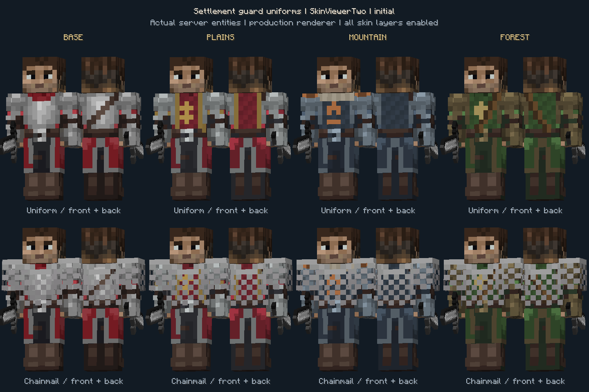
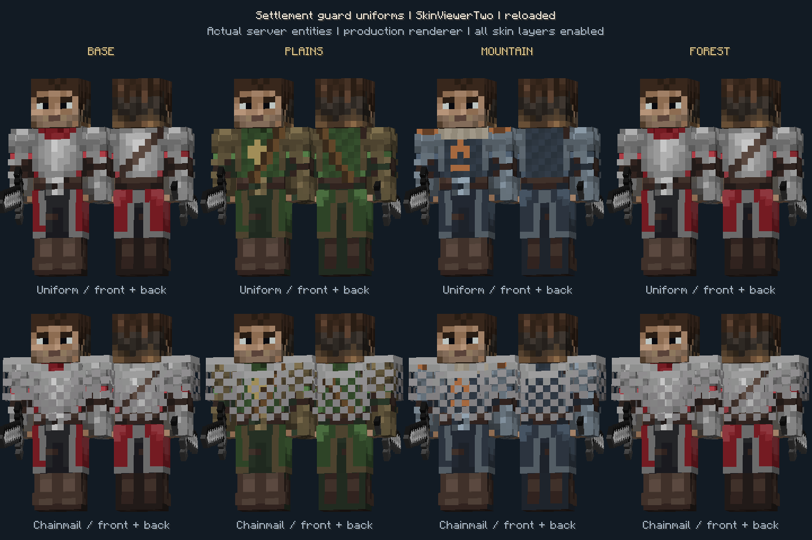

# Guard patrol integration

All development in this slice belongs to **`2nd-test`**. Arthur's **`test`** is a
read-only upstream reference. Integration commit `98634d9` retains both branch
histories and uses `test` commit `41653db` for the shared settlement/trade core.

## Boundaries

- Guard behavior: `entity/VillageGuardEntity.java`.
- Guard rendering: `client/renderer/VillageGuardRenderer.java`.
- Read the shared settlement API; do not introduce a second warehouse, trade
  service, relationship model or NBT schema for guards.
- Sealed-crate and mount-cargo sources are archived under
  `prototypes/sealed-cargo`. They are outside the Gradle source set.
- The original `2nd-test` state remains at
  `codex/backup-2nd-test-20261025` (`1b59c3d`). Old prototype worlds require a
  separate migration before use with the new trade core.

## Current behavior

- Spawned guards bind to a registered settlement at their position and retain
  their existing iron sword and chainmail equipment.
- A guard does not despawn because the player walks away.
- Settlement affiliation survives NBT reload. The patrol restriction is
  restored on load and refreshed once per second, including center/radius
  changes and removal of the settlement.
- Returning to the patrol area has priority over melee pursuit. A guard drops
  targets outside the patrol area and no longer attacks after relations cease
  to be hostile.
- Same-settlement, neutral, friendly and allied guards are not valid targets,
  including retaliation. Unassigned guards do not fight other guards.
- A guard will not attack villagers, iron golems, its leader, or leaders of
  friendly/allied settlements. Other players are not acquired proactively;
  the existing retaliation goal may target them if they attack the guard.
- Guards use the custom base/plains/mountain/forest textures in
  `assets/villagediplomacy/textures/entity/guard`. The primary specialization of
  the home settlement selects the uniform; unbound/unassigned guards use base.
  Standard entity metadata synchronizes the type to newly tracking players and
  existing viewers. It is derived again from the saved home on entity load.
- The wide `PlayerModel` draws the hat, jacket, sleeves and trouser overlays.
  Regional details also appear on the opaque outer cuirass. Actual equipped
  chainmail stays visible and retains its original protection and drop chance.
- Hostile mobs receive a guard-targeting goal when they enter the server level,
  including after chunk/world reload. Existing retaliation and player/villager
  targets retain their higher priorities. Brain-driven hostile mobs also receive
  the corresponding attack memory; slimes and magma cubes can deal contact
  damage to a guard they are chasing.
- Spider acquisition still requires darkness. Endermen, zombified piglins,
  ordinary piglins and wardens retain their existing anger/gold/sensory rules.

## Verification commands

```powershell
.\gradlew.bat test build --offline
.\gradlew.bat -PguardGameTests runGameTestServer --offline
```

The first successful run may need online dependency resolution without
`--offline`. GameTest sources and the original test-arena NBT are included only
when `-PguardGameTests` is explicitly supplied. Every run creates a fresh world
under `build/guard-gametest-runs/<run-id>`, leaving `run/saves` untouched.
Regenerate the arena with `python tools/create_guard_test_arena.py`.

The server scenarios exercise spawn/equipment, NBT reload, center/radius
updates, friendly retaliation, changing diplomacy during combat, protected
leaders/civilians, an escaping enemy, return navigation, actual monster damage,
and cleanup after deleting a settlement.

The hostile-mob regression scenarios use a guard with AI disabled, so damage
proves the monster initiated combat instead of merely retaliating. They cover
melee, ranged attacks, creeper fuse activation, spiders in dark/bright conditions,
slime/magma contact damage, hoglin and piglin-brute brains, neutral endermen,
and reloaded mobs.

For a manual mutual-combat check, restart the client with the updated code, then
spawn a guard and run `/summon minecraft:husk ~4 ~ ~` near it on Normal difficulty.
Do not add `{NoAI:1b}` to the hostile mob: that deliberately disables its movement
and attacks. No replacement of existing guards is required.

The four skin GameTests additionally verify spawn/reassignment, primary versus
secondary type, reload/fallback, changed/deleted homes and encoded entity
tracking/update packets. There are 25 required guard GameTests in total.

For a real multiplayer rendering check, use a fresh directory each time:

```powershell
.\gradlew.bat -PguardSkinCheck -PguardSkinCheckDir=build/guard-skin-check-new writeGuardSkinCheckLaunch --offline
node tools/run_guard_skin_check.cjs build/guard-skin-check-new
```

This opt-in harness starts a server bound to `127.0.0.1:25579` and two dev
clients with separate game directories. It uses an offline local server, eight
real tracked guards, the production renderer, and all skin layers. It captures
front/back views without and with actual spawn chainmail, checks live home-type
changes/removal, saves and fully restarts the server, then reconnects both
viewers and verifies persisted uniforms. Both clients and the server exit
automatically. The runner refuses to reuse an existing test world. The optional
sources are under `src/skincheck/java` and are not part of a normal release.

The client gallery verifies rendering and network/save behavior, not animated
combat or ordinary player interaction. Those are separate gameplay checks.
Build a regular release after GameTests; test classes and arena resources must
not be present in the release jar.

## Verified appearance, 2026-10-26

Two independent Minecraft 1.20.1 / Forge 47.4.28 dev clients completed the
scenario above against the same local server. All eight entity metadata checks
passed in each client before and after live updates and a full server restart.
The raw screenshots below were visually inspected. The first image preserves
the initial four types. Column labels identify the original test groups;
the top row has no equipped chestplate and the bottom row has normal chainmail.
Each pair shows front and back. After reconnecting to the restarted server,
the originally plains guards correctly wear forest uniforms, and the originally
forest guards use base because their home was deleted during the test.





Machine-readable results, asset hashes and release checks are in
`guard-skins-verification.json`. Full local run artifacts are retained under
`build/guard-skin-client-check-04`; these ignored runtime files are not shipped.
