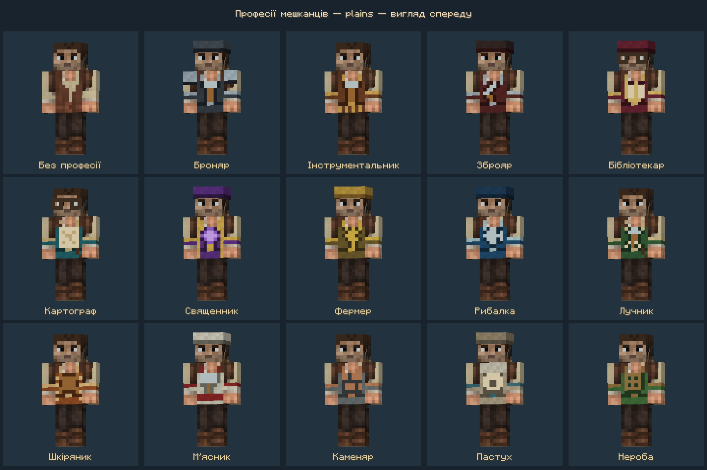
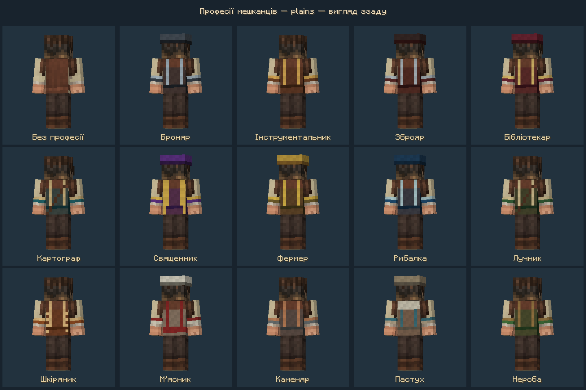
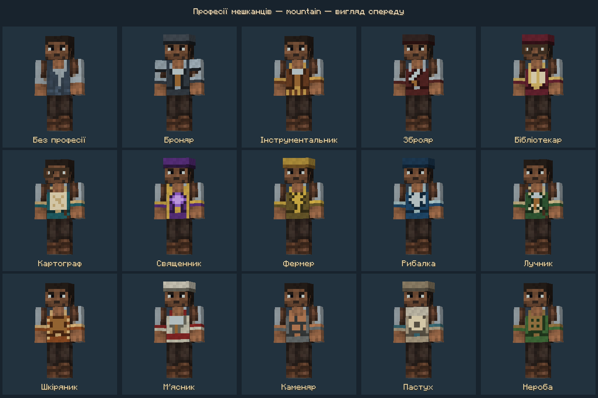
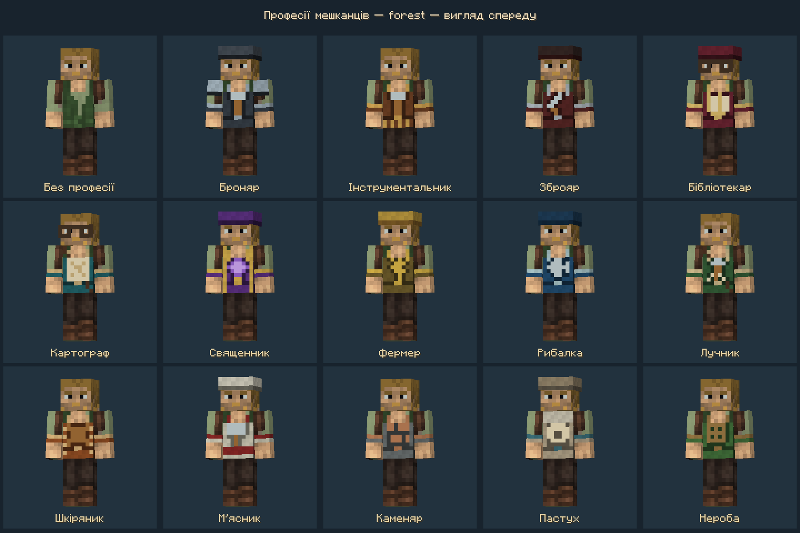

# Впізнавані професії жителів — 0.2.1

Замість трьох спільних груп кожна торгова професія Minecraft має власний одяг. Текстури 64×64 використовують стандартну широку людську модель, непрозорі базові грані та бінарну прозорість. Головні убори й окуляри нанесені на зовнішній шар голови. Зображення інструментів — піксельні деталі одягу, а не нові предмети в руках чи зміни інвентарю.

| Професія | Характерні відмінності |
|---|---|
| Броняр | Графітовий фартух, сталевий молот, світлі наплічники |
| Інструментальник | Мідно-коричневий фартух із молотом, пояс інструментів |
| Зброяр | Темно-червоний фартух із мечем, сталеві манжети |
| Бібліотекар | Бордовий камзол і шапочка, розгорнута книга, окуляри |
| Картограф | Бірюзовий жилет із картою, діагональний ремінь, окуляри |
| Священник | Фіолетовий одяг, золоте оздоблення, аметистовий візерунок |
| Фермер | Солом’яний головний убір, робочий комбінезон, колосся |
| Рибалка | Синій фартух зі сріблястою рибою, темна шапка |
| Лучник | Зелений жилет, стріла, ремінь сагайдака |
| Шкіряник | Рудий шкіряний фартух із латкою й контрастними швами |
| М’ясник | Білий фартух і ковпак, червоний пояс, сікач |
| Каменяр | Сірий фартух із цегляним візерунком |
| Пастух | Світла вовняна накидка, овечка, кольоровий пояс |
| Без професії | Початкова регіональна сорочка й жилет |
| Нероба | Зелений одяг із латками |

Три поселення × 15 комплектів × три сталі палітри обличчя = **135 варіантів**. Регіональні кольори зберігаються на сорочці й частинах одягу. Зовнішні аксесуари не змінюють базові пікселі голови: людина зберігає впізнаване обличчя після зміни професії, вербування й демобілізації.

`ResidentAppearance` читає поточну професію з ванільних даних жителя при виборі текстури. Після отримання або зміни роботи відповідний одяг змінюється без перезаходу. Невідомі професії інших модів використовують регіональний `worker`; відсутніх текстур для них не запитуємо. Формат збереження світу, торгівля та механіка гарнізону не змінені.

## Відтворення та редагування

```powershell
node tools/create_resident_skins.cjs
node tools/verify_resident_skins.cjs
```

PNG та редаговані `.bbmodel` лежать у `prototypes/resident-skins`. Базовий ImageGen-атлас з попередньої версії збережений; професійні деталі відтворює `tools/resident_professions.cjs`. Автоматична перевірка читає готові файли, перевіряє розмір, прозорість, відсутність дірок базової моделі, унікальність, збереження базової голови й відповідність вбудованих та ігрових текстур.

## Клієнтська перевірка

```powershell
.\gradlew.bat -PguardSkinCheck -PprofessionCheck -PguardSkinCheckDir=build/profession-check-fresh writeGuardSkinCheckLaunch --offline
node tools/run_guard_skin_check.cjs build/profession-check-fresh uk_ua --gallery
.\gradlew.bat test build --offline
```

Перша команда готує ізольований сценарій; друга запускає localhost-сервер і два незалежні клієнти. Тестові код і світ не входять до звичайної збірки. Галерея малює справжніх відстежуваних жителів через робочий рендерер мода. Сценарій декодує всі 135 ресурсів та змінює професію одного жителя на сервері через усі 15 варіантів; обидва клієнти перевіряють актуальний шлях текстури.

Перевірено 2026-11-03 у `build/profession-client-check-02`: обидва клієнти успішно пройшли сценарій, усі три процеси завершилися з кодом 0. Чотири наведені кадри — прямі знімки буфера Minecraft, візуально оглянуті після захоплення. Галерея показує всі професії спереду й ззаду та представників усіх трьох регіонів/палітр обличчя; автоматична частина перевіряє решту комбінацій. Готовий JAR перевіряється окремо на склад ресурсів і відсутність тестового коду. Деталі й контрольні суми — у `resident-professions-verification.json`.

Ця перевірка охоплює вигляд та синхронізацію професії; тривалу гру з усіма торговими пропозиціями, народженням і поведінкою жителів у цьому завданні не повторювали. Клієнтський сценарій використовує робочий код у Forge dev-середовищі; установлення JAR у користувацьку збірку окремо не виконувалося.








