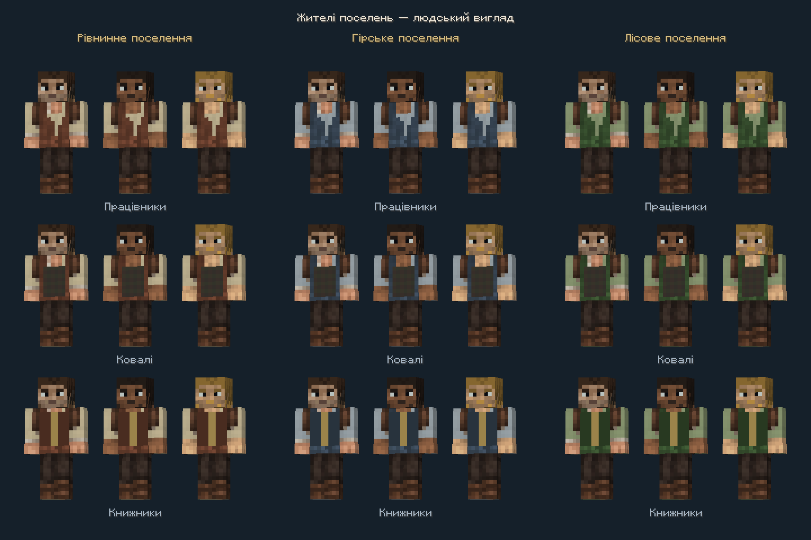
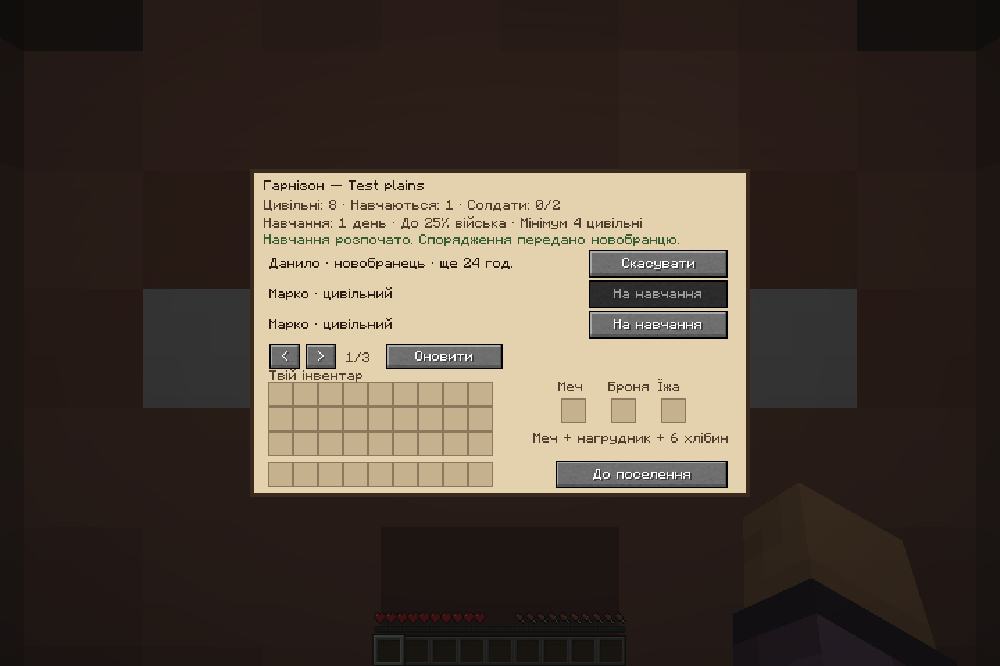
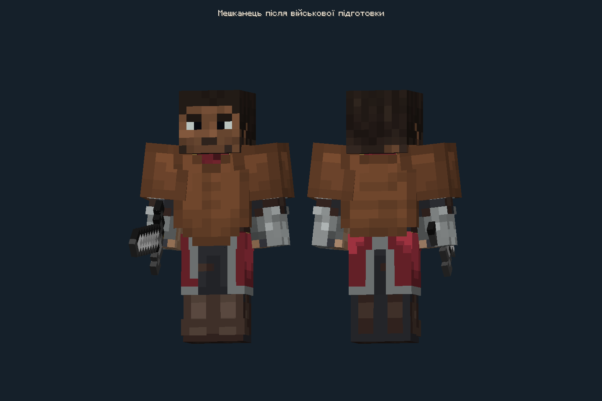
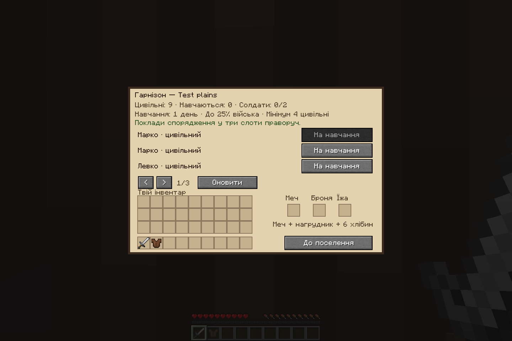

# Human residents and recruitment

Work belongs to `2nd-test`; `test` is read-only.

## Player flow

1. Register and lead a settlement using its bell and leadership seal, then place a diplomacy table near the bell.
2. Open the table and choose **Гарнізон / Garrison**. Other players can view the roster; only the current settlement leader can manage it.
3. Place a chosen sword, a chosen chestplate and at least six bread in the three supply slots. These are normal inventory slots, not implicit withdrawals from the player's inventory or the settlement warehouse. Shift-click moves suitable items into the appropriate slot.
4. Choose an available adult unemployed resident. Training takes **24,000 game ticks**, one Minecraft day. The trainee remains a civilian entity in the world with AI paused while training; the previous AI setting is restored on cancellation/demobilization. Materials are reserved on that trainee. Closing the menu returns only unused items still in the supply slots.
5. After training, that specific resident becomes a guard using the supplied weapon and chestplate. The original civilian disappears. Name and face are retained.
6. The garrison can cancel training with a full refund or demobilize a recruited guard who is not currently fighting. Demobilization restores the original villager UUID, data, name, XP and inventory, and returns the guard's current equipment once. Health is transferred proportionally; changing roles does not heal damage for free. Former bed/workstation memories are cleared so a returned resident can find a valid home/job again.

The roster snapshot updates when reopened or when **Оновити / Refresh** is pressed. Newly training residents and soldiers appear before ordinary civilians. Residents in unloaded chunks cannot be acted on until available again.

## Population rules

- Children and employed villagers cannot be recruited. Children do not count toward the adult population.
- Keep at least **four adult civilians** after starting a new recruit.
- Soldiers **plus queued trainees** cannot exceed `floor(total known adults / 4)`.
- Ordinary existing guards also count toward the military limit, but only guards with a saved civilian origin can be demobilized. A creative spawn egg has no original resident to restore.
- Population records survive chunk unloading. A corpse, confirmed removal, conversion or travel to another dimension updates the originating roster; merely unloading terrain does not create another army place.
- New soldiers come from real residents completing training. No free periodic soldier spawner or neutral-settlement automatic recruitment is included in this first version.

## Appearance and vanilla behavior

Ordinary residents remain `minecraft:villager` entities. A wide human PlayerModel replaces their renderer, preserving the original trade, profession, breeding and villager AI implementation. Children use the model's baby rendering. Three regional palettes (plains/mountain/forest), three identity palettes and three clothing groups (worker/smith/scholar) provide 27 civilian textures.

Civilian appearance uses the settlement's primary specialization, synchronized explicitly to tracking clients. Outside registered settlements, a vanilla villager type provides a regional fallback. Professions select the clothing group. UUID selects a stable head palette. Recruited guards synchronize their original resident UUID and use matching guard textures; demobilization restores the same UUID and civilian appearance.

Art source, editable Blockbench projects and the ImageGen prompt are under `prototypes/resident-skins`. The generated clothing atlas is fitted deterministically to the 64x64 UV grid. The supplied guard head is preserved for palette zero, with matching head palettes generated for civilians and recruited soldiers. See `tools/create_resident_skins.cjs`.

## Implementation boundaries

- Shared `Settlement`, trade contracts and warehouse production schemas are unchanged.
- `GarrisonSavedData` stores a separate per-dimension population ledger keyed by original person UUID.
- Villager `ForgeData` stores home affiliation and training escrow, deadline and original snapshot. The guard's NBT stores the original villager snapshot; entity metadata synchronizes the origin UUID to clients.
- Appearance packets are server-to-client only. Inventory uses normal container slot packets. Management uses a container-scoped original-person UUID packet with fresh server-side leadership, population, eligibility, home and item validation. UI snapshots are not authority. Vanilla button packets are limited to a signed byte, so they are used only for the small navigation commands.
- Completion first adds the new guard successfully, then removes the old resident. Demobilization first adds the restored resident successfully, then returns equipment and removes the guard. UUID collisions cause a refusal instead of duplicating a resident.
- Training time advances with world game time, and a loaded trainee completes after its deadline. No wall-clock/offline progression or permanent chunk loading is introduced.

## Verification

```powershell
.\gradlew.bat -PguardGameTests runGameTestServer --offline
.\gradlew.bat test build --offline
```

An optional real-client scenario can be prepared using a fresh directory:

```powershell
.\gradlew.bat -PguardSkinCheck -PresidentCheck -PguardSkinCheckDir=build/resident-check-fresh writeGuardSkinCheckLaunch --offline
node tools/run_guard_skin_check.cjs build/resident-check-fresh uk_ua
```

It uses a dedicated localhost server, two independent clients and separate disposable save/config folders. It checks all 27 appearances, a leader versus a read-only viewer, real container shift-click and action packets, training escrow after a full server restart, the recruited guard's identity and actual supplied gear, demobilization and exact equipment/population restoration. The optional sources are excluded from regular release builds.

## Verified client results, 2026-10-26

Both clients completed the scenario in `build/resident-client-check-03`. The leader used real inventory shift-click packets to supply equipment and the real menu-scoped management channel to recruit and demobilize. A second client could view but could not recruit, including a deliberately sent unauthorized request. The server was fully saved and restarted while training was in progress. The original resident then completed training and was restored by demobilization. The original civilian UUID/appearance, population counts and exact equipment return were checked.

The raw images below were visually inspected. The gallery is a test screen rendering actual tracked villager entities through the production renderer. The garrison captures use the actual product screen. Training was accelerated only after the restart in this optional harness; normal gameplay still requires 24,000 ticks. Ordinary villager AI/trading/breeding is retained by keeping the original entity type; this scenario does not constitute an extended gameplay test of all vanilla professions or breeding behavior.









Final server/unit/package results are recorded in `residents-garrison-verification.json`. The new release is `build/libs/villagediplomacy-0.2.0.jar`; server and clients must use the same build. Historical guard-only 0.1.0 artifacts remain separate.
