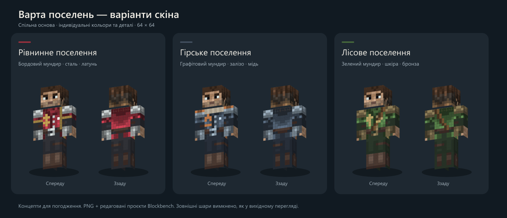

# Скіни варти поселень

Три варіанти на основі наданого користувачем скіна. Вони відповідають поточним типам поселень у `SettlementSpecialization`.

| Тип поселення | PNG | Проєкт Blockbench | Оформлення |
| --- | --- | --- | --- |
| Рівнинне (`PLAINS`) | `guard_plains.png` | `guard_plains.bbmodel` | Бордовий мундир, сталь, латунна облямівка й знак колоса |
| Гірське (`MOUNTAIN`) | `guard_mountain.png` | `guard_mountain.bbmodel` | Графітовий мундир, світлий вовняний комір, мідні заклепки й знак гори |
| Лісове (`FOREST`) | `guard_forest.png` | `guard_forest.bbmodel` | Зелений мундир, шкіряний ремінь, бронзові деталі й знак листка |

## Редагування

Відкрийте потрібний `.bbmodel` у Blockbench. Текстура вбудована у проєкт; відповідний PNG лежить поруч. Формат: Minecraft Skin / Steve, широкі руки, 64 × 64 пікселі. `guard_base.png` і `guard_base.bbmodel` зберігають вихідну основу. Зовнішні шари у початковому перегляді Blockbench були вимкнені; порівняльне зображення показує базовий шар.

## Статус перевірки

- Після збереження PNG повторно прочитані: розміри 64 × 64, прозорість і вся область голови збережені без змін. Результати: `validation.json`.
- Порівняльне зображення створене з експортованих PNG і переглянуте візуально.
- Відкриття готових `.bbmodel` у Blockbench не завершено: користувач зупинив керування програмою клавішею Escape. Вихідний скін був видимий на моделі у Blockbench.
- Варіанти збережені як прототипи. Вибір текстури за типом поселення ще не підключений до `VillageGuardRenderer`; перевірки у грі не було. Прозорі зовнішні шари також потребують окремої візуальної перевірки.

## Відтворення

З кореня репозиторію: `node tools/create_guard_skins.cjs`. Потрібні Node.js і пакет `sharp`; у локальному середовищі Codex скрипт також шукає вбудований `sharp`. Вхід за замовчуванням — `prototypes/guard-skins/guard_base.png`, вихід — ця папка. Скрипт перезаписує згенеровані варіанти; збережіть ручні правки під окремою назвою перед повторним запуском.

Першим аргументом можна задати інший вихідний PNG, другим — іншу папку результатів. Це дає змогу відтворити результат окремо від ручних правок.

## Походження

Базовий скін надав користувач як `de0fe96cd98e19a0.png`. Первісний автор і ліцензія не встановлені; цей опис не приписує авторство базового скіна проєкту Village Diplomacy. Похідні кольори, облямівка, комір, ремінь і значки підготовлені в межах цього завдання.
