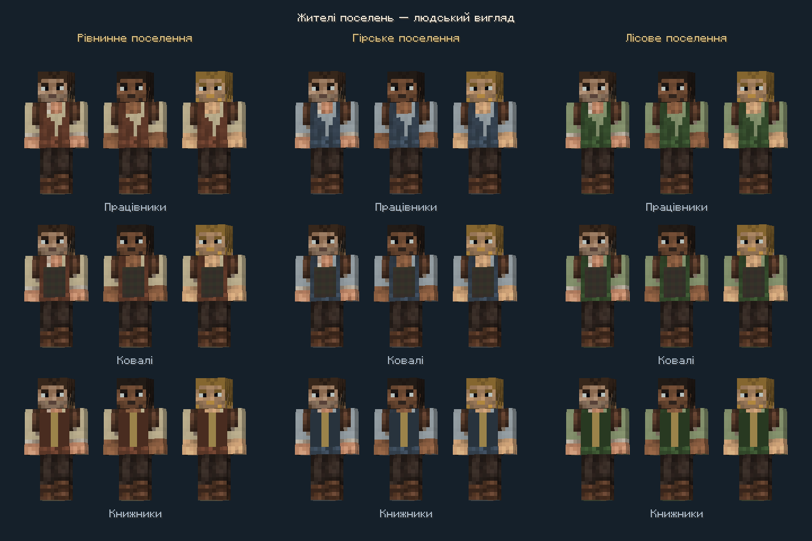

# Цивільні скіни мешканців

135 варіантів для стандартної широкої людської моделі Minecraft: три типи поселень × 15 комплектів одягу × три палітри обличчя.

- `plains` — світла лляна сорочка й коричневий жилет.
- `mountain` — холодні сірі тканини й темний жилет.
- `forest` — приглушені зелені тканини.
- `worker` — безробітний; `nitwit` — нероба. Решта назв відповідає окремим професіям Minecraft: `armorer`, `toolsmith`, `weaponsmith`, `librarian`, `cartographer`, `cleric`, `farmer`, `fisherman`, `fletcher`, `leatherworker`, `butcher`, `mason`, `shepherd`. Старі спільні групи `smith`/`scholar` замінені індивідуальними комплектами.
- Суфікс `0`, `1`, `2` — сталі варіанти волосся та тону обличчя, які обираються за UUID мешканця.

Відкривайте відповідний `.bbmodel` у Blockbench; PNG вбудований у проєкт і лежить поруч. Робочі текстури також збережені в ресурсах мода. У цивільних скінах зовнішні шари тулуба й кінцівок прозорі, а головні убори й окуляри використовують зовнішній шар голови. Увімкніть його для перегляду аксесуарів.

Базова голова мешканця й солдата з тим самим походженням має точно однакові пікселі; професійні аксесуари додаються окремим зовнішнім шаром. Початкова голова походить зі скіна, наданого користувачем. Його початковий автор і ліцензія не встановлені. Базовий цивільний одяг створений вбудованим ImageGen за `generation-prompt.txt`; fal та зовнішні платні API не використовувалися. `source/civilian-generated.png` зберігає результат генерації до підготовки для гри. Характерні професійні фартухи, ремені, емблеми й аксесуари намальовані піксельним кодом у `tools/resident_professions.cjs`.

Відтворення з кореня репозиторію: `node tools/create_resident_skins.cjs`. Потрібні Node.js і `sharp`; скрипт також знаходить вбудований пакет локального середовища Codex. Він оновлює прототипи, ресурси цивільних і додаткові варіанти облич солдатів. Ручні правки слід зберігати під окремими назвами перед повторним запуском.

Перевірка файлів: `node tools/verify_resident_skins.cjs`. Каталог професій та актуальні знімки гри — у `docs/development/resident-professions.md`; механіка вербування — у `docs/development/residents-garrison.md`.

Історичний вигляд 0.2.0:

